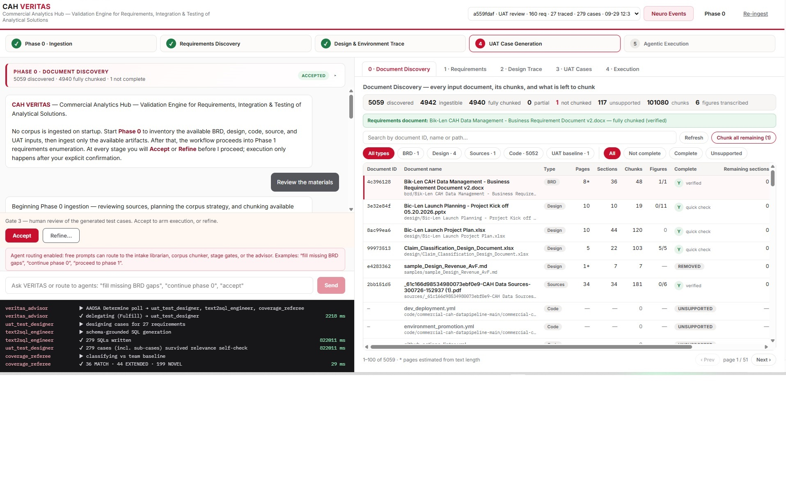
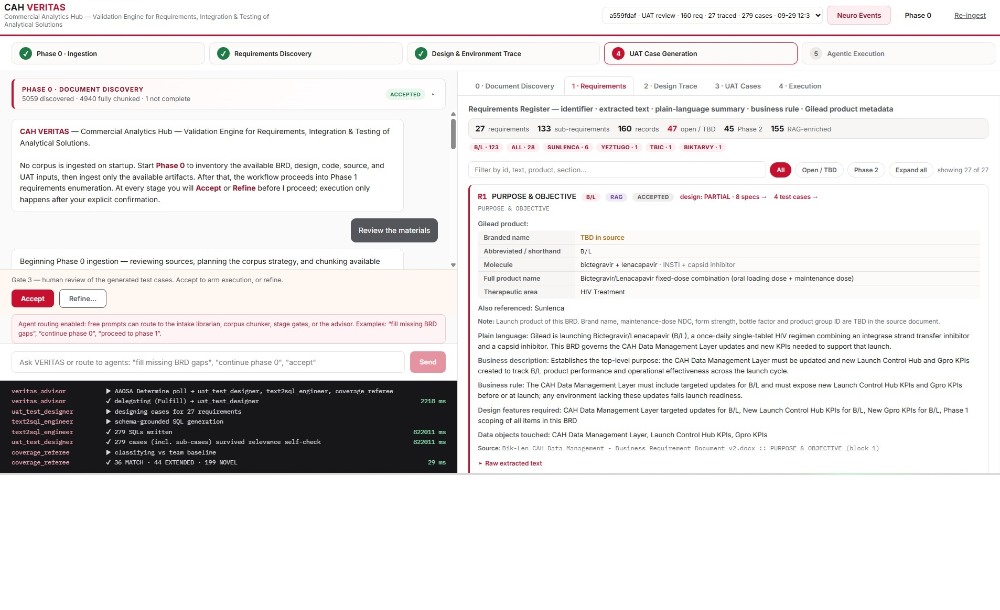
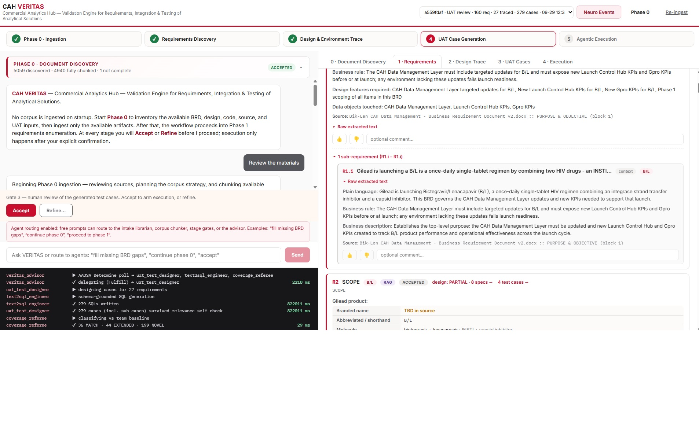
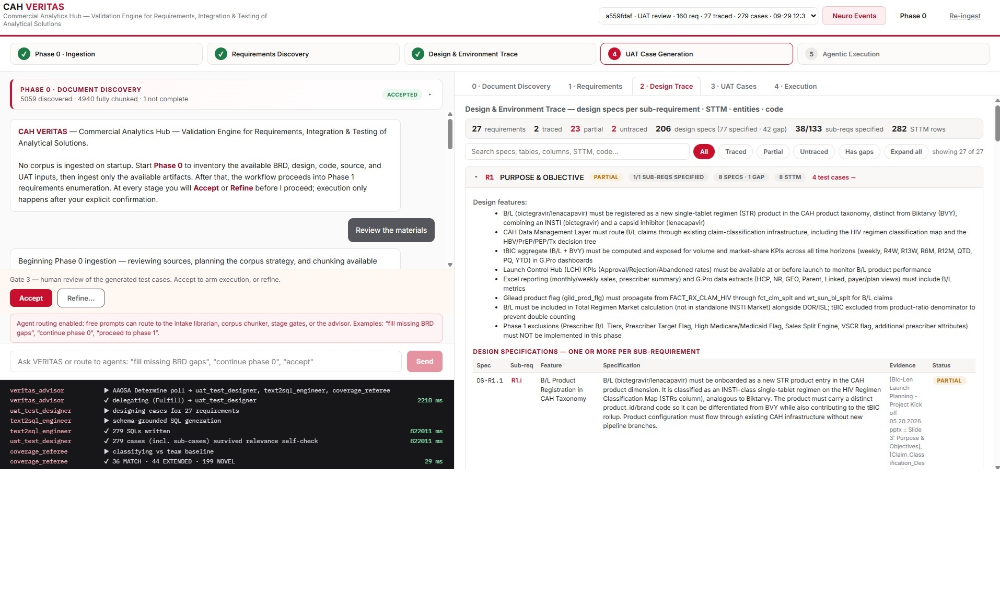
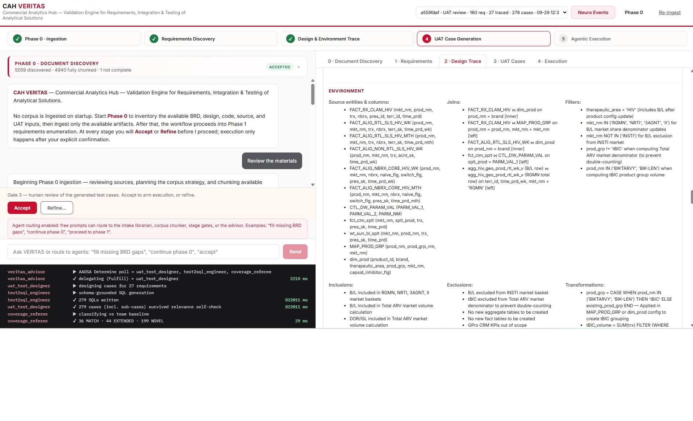
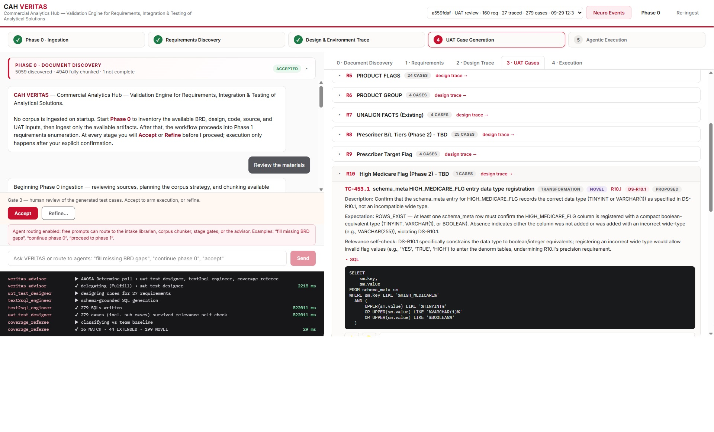

# CAH VERITAS — Screenshots

**CAH VERITAS** (Commercial Analytics Hub — Validation Engine for Requirements, Integration & Testing of Analytical Solutions) runs a gated, multi-agent workflow:

**Phase 0 · Ingestion → Requirements Discovery → Design & Environment Trace → UAT Case Generation → Agentic Execution**

Each screenshot below shows the same layout:

- **Left:** the VERITAS conversation panel, with the stage-gate controls (**Accept** / **Refine…**) and the agent-routing prompt box.
- **Bottom-left:** the live agent activity log (`veritas_advisor`, `uat_test_designer`, `text2sql_engineer`, `coverage_referee`).
- **Right:** the tab for each workflow stage.

The run shown is `a559fdaf` (UAT review): 160 requirement records, 27 requirements traced to design, 279 test cases.

---

## 1. Document Discovery

The **0 · Document Discovery** tab lists every input document, how it was chunked, and what is still left to chunk:

- **5,059** documents discovered and **4,940** fully chunked, producing **101,080** chunks.
- **1** document is not yet chunked and **117** are unsupported file types.
- The BRD (*Bik-Len CAH Data Management – Business Requirement Document v2.docx*) is fully chunked and verified.
- You can filter by document type (BRD, Design, Sources, Code, UAT baseline) and by completion status. **Chunk all remaining** chunks whatever is left.

---

## 2. Requirements Register

The **1 · Requirements** tab holds the requirements register:

- **27** requirements, **133** sub-requirements and **160** records.
- **47** requirements are open or TBD, **45** are Phase 2 and **155** are RAG-enriched.
- Each requirement (here **R1 Purpose & Objective**) shows:
  - its Gilead product metadata (B/L — bictegravir + lenacapavir, HIV Treatment)
  - a plain-language summary, business rule and business description
  - the design features required and the data objects it touches
  - a citation back to the source BRD block

---

## 3. Sub-Requirements & Reviewer Feedback

Expanding a requirement shows its sub-requirements. Here it is **R1.i**, with the raw extracted text, plain-language summary, business rule and source citation. Reviewers can give each item a thumbs up or down and add an optional comment.

---

## 4. Design Trace — Features & Specifications

The **2 · Design Trace** tab maps each requirement to its design specs, STTM rows, entities and code:

- **2** requirements are traced, **23** partial and **2** untraced.
- **206** design specs (77 specified, 42 with gaps), **38 / 133** sub-requirements specified and **282** STTM rows.
- For R1 it lists the required design features and the design specifications table (for example **DS-R1.1** B/L Product Registration in CAH Taxonomy), with evidence and a status for each spec.

---

## 5. Design Trace — Environment

The **Environment** section of the design trace lists the data-level detail each requirement needs:

- **Source entities and columns**, such as `FACT_RX_CLAM_HIV`, `FACT_ALIG_*` and `dim_prod`
- **Joins**
- **Filters**, **inclusions** and **exclusions** (for example, B/L is excluded from the INSTI market basket and tBIC from the Total ARV denominator)
- **Transformations**, such as the `tBIC` product-group CASE logic

---

## 6. UAT Cases

The **3 · UAT Cases** tab groups the generated test cases by requirement, for example **R5 Product Flags** (24 cases) and **R8 Prescriber B/L Tiers** (25 cases). Each case includes:

- a description, the expected result and a relevance self-check
- the schema-grounded SQL written by `text2sql_engineer`
- tags for its category, novelty, the sub-requirement and design spec it covers, and its status

The case shown is **TC-453.1**, which checks the data type registered for `HIGH_MEDICARE_FLG`.

The coverage referee compared the cases with the team's baseline: **36 MATCH · 44 EXTENDED · 199 NOVEL**.
